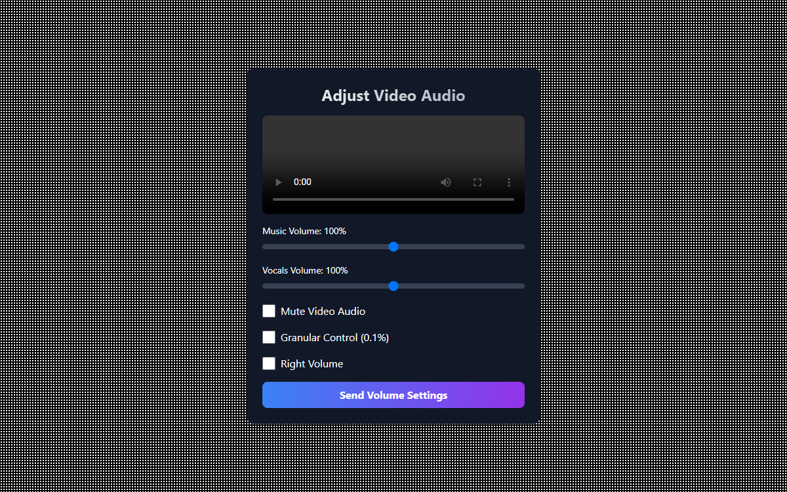
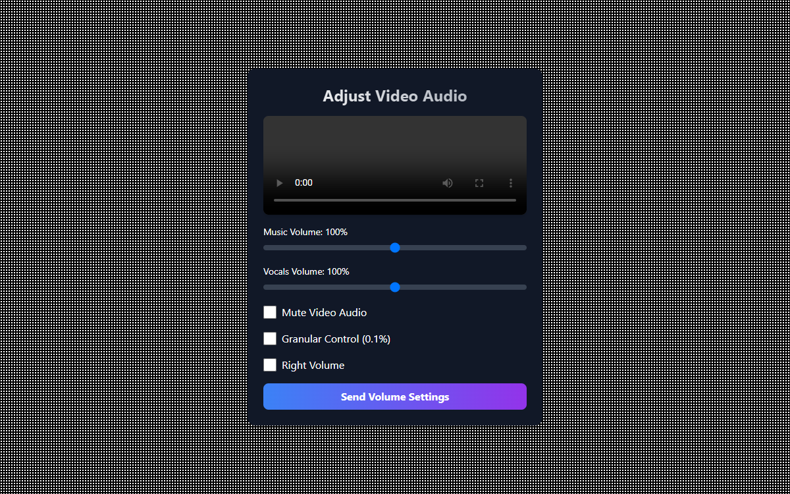
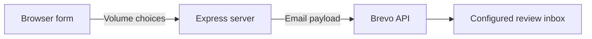

# Video Volume Adjuster

Vague client notes like 'make the music a bit softer' create endless revision loops without explicit numerical references. This review tool provides client-facing sliders for background music and vocal levels, packaging preferences and mute selections into a structured payload sent directly to the editor via the Brevo email API. The browser interface is focused purely on collecting client preferences rather than real-time audio re-mixing or playback. Fork the review workflow for your own client handoffs and adapt the form fields to your post-production pipeline.

*Click preview above to watch recorded interface demo.*

## Try the review workflow

1. From this folder, run `npm install`.
2. Add a local `.env` with `BREVO_API_KEY`, `EMAIL_FROM`, and `EMAIL_TO`. Use a Brevo-approved sender and your own test inbox for an end-to-end test.
3. Supply the files referenced by [the review page](public/index.html) at `public/videos/video.mp4`, `public/audio/music.mp3`, and `public/audio/vocals.mp3`.
4. Run `node server.js`, open [localhost:3000](http://localhost:3000), choose the music and vocal settings, and click **Send Volume Settings**.

The current submission path emails the chosen slider values and mute preference. The checked-in client does not wire the sliders to live playback, and the sample media is external. Treat this as a feedback-form prototype. Run the email endpoint privately while testing.

## Interface preview

Local interface capture; media files and the submission service are not configured.

[Watch the local controls interaction recording](docs/media/volume-controls.webm) (no backend submission or audio playback is shown).

## Request flow

The repository does not include the media files named above. This version sends review settings; it does not render or export an adjusted video mix.
